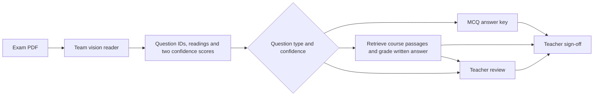

# Group Assignment Report

- **Team** (Blackboard group name):
- **Section**: [BBADBA 5A | BBADBA 5B | PPLEDBA 5A]
- **Space URL**:
- **Final commit** (tag `final`):

*At most about 3,000 words, tables excluded. Members and who did what go in CONTRIBUTIONS.md.*

## Business case

*Who uses it, which decision or task it supports, what happens today without it (the baseline), the success metric, and a rough value in euros with the assumptions behind it.*

## Architecture

*The two components and how one feeds the other: a diagram plus a short walk-through of one request from input to output. Which models or APIs, and why those. What you reused from assignments 1–3, and whose it was.*

The Component 2 interface accepts a versioned handoff. On the bundled engineering example, Q1 contains a clear B, which earns a proposed 1. Q17 contains D on a two-option question and goes to review. The teacher sees the readings, proposed marks, reasons and evidence. A final sheet requires the teacher to complete all 35 marks. The PDF route awaits acceptance with Anna's reader. [Handoff and acceptance procedure](HANDOFF.md)

## Data

*Where each component's data comes from, with links, licences and sizes. Confirm that there is no personal data in your inputs or logs.*

The answer catalogue contains 20 multiple-choice and 15 written questions. Recorded teacher marks are used for evaluation. The public teaching index contains 367 paragraphs from 25 pages, also grouped into 157 section chunks. Precomputed Gemini embeddings allow local retrieval. Student text is used locally for lexical matching. External grading requires a server-approved input. Safe request logs omit answer text, filenames and model feedback. [Dataset, licences and attribution](SOURCES.md)

## Evaluation

### Components

*Each component on its own: the metric, the result, the test data and its size.*

| Component 2 measurement | Observed result | Scope |
|---|---|---|
| MCQ key replay | 987/987 valid letters scored according to the key. All 13 unusable entries went to review. | 50 papers, 1,000 recorded slots, transcription assumed correct. The teacher total agreed on 13/44 complete sheets. [MCQ evidence](eval/published_mcq_replay.json) |
| Retrieval | Approved page in top three for 14/14 answerable written questions with both semantic designs. Lexical search reached 11/14 for sections and 10/14 for paragraphs. | Question-only queries on the team's reviewed worksheet. Q34 lacks its figure. Labels identify pages, so a passage may still cover only part of an answer. [Semantic results](eval/written_retrieval_semantic.json) · [Lexical results](eval/written_retrieval_lexical_v3.json) |
| Written grading | 17/30 proposals, 13/30 reviews. Among the 16 proposals with a numeric teacher mark, 12 agreed exactly and 13 were within half a point. Mean absolute error was 0.25/2. The training-exam question-mean baseline on the same 16 had 3 exact and mean absolute error 0.50/2. | Replayed two previously transcribed papers. One proposal lacks a numeric reference. Both thresholds gave identical decisions with frozen responses. One missing response was referred. [Frozen replay](eval/written_semantic_frozen_thresholds.json) · [Live run](eval/written_semantic_section_replay.json) |
| Q32 | 45/50 referred. Of five proposals, four had a numeric teacher reference. All four matched and were zero. | Development replay on papers already examined during rule changes. [Q32 evidence](eval/q32_all50_svm_only.json) |

### Additional written comparisons

The original semantic grader's results varied across papers. On the two pilot papers it matched 9/21 paired marks and had mean absolute error 0.76/2, compared with 0.38/2 for the question-mean baseline. All 12 disagreements were under-awards. One answer described K-nearest-neighbor voting for the K-means question. The published key specifies cluster count, yet the teacher recorded 2/2. [Pilot replay](eval/written_semantic_pilot_frozen.json) · [Published key](exam_grader/data/answerkey.txt)

For a separate test, two further papers were selected by a fixed ordering before reading their marks. It covered 28 written slots after excluding Q32. The grader proposed 13 marks, matched five exactly and sent 15 to review. Seven proposals were at least one point below the teacher. The grader's mean absolute error was 0.65/2, compared with 0.46/2 for the baseline on the same 13. All eleven partial-credit outputs accounted for the points deducted. [Independent evaluation](eval/written_independent_semantic.json)

On a subsequent replay of the same 28 independent-test slots, the revised agent and passage selection produced 15 marks, matched the teacher on 8/15 and referred 13 slots. Five answers left review and three entered review. Of ten answers marked in both runs, two moved closer to the teacher and eight had the same absolute error. The revised grader's mean absolute error and that of the baseline on the same 15 were both 0.50/2. Six revised proposals under-awarded by at least one point. This is a repeat comparison on the same papers. [Revised replay](eval/written_independent_revised.json) · [Score matrix](eval/written_review_policies.json)

The final Component 2 test froze the revised grader at `c4b76bb` and used four further papers from the existing sampling order. Across 56 written slots excluding Q32, 31 received proposals and 25 went to review. Of 30 paired proposals, 16 matched the teacher and 17 were within half a point. The question-mean baseline, trained on 40 other papers, achieved 7 exact matches and 24 within half a point on the same 30. Respective mean absolute errors were 0.55/2 and 0.52/2. Twelve proposals were at least one point below the teacher and one was at least a point above. All 20 below-full-credit proposals accounted for their deductions. The test used manual transcriptions to isolate the grading component. [Four-paper test](eval/written_validation_four.json)

### Generalization to new students and different questions

The teacher can load a new written exam with its own questions, reference answers, two-point rubrics and course materials. A fingerprint binds the reader export to the chosen exam. Each proposed mark needs a body passage for every criterion. A second call to the same model scores the answer without seeing the first mark. A difference of one point or more, an ambiguous second mark or inadequate evidence sends the answer to review. Both calls can still make the same mistake. The checked reader interface and sample physics exam are available in the handoff. [Custom exam workflow](README.md#use-a-different-written-exam)

**Machine-learning exam.** Four papers were sampled before reading their answers. Manual transcriptions isolate grading from handwriting recognition. Of 52 eligible slots, 39 contained readable responses and 13 had no located answer. Q28 and Q32 were excluded because all 50 papers had already informed development on those questions. Both arms used the same four papers and the same model, `gemini-3.1-flash-lite`. The earlier model's daily quota interrupted the first comparison. Its incomplete outputs are preserved separately. Four service or response-format failures remained in each of the comparison arms and count toward reviews. [Sampling, per-question decisions and frozen outputs](eval/generalization_ml_four.json)

| Configuration | Proposed / readable | Reviews / readable | Exact / comparable proposals | Off by ≥1 / comparable proposals | Mean absolute error out of 2 |
|---|---:|---:|---:|---:|---:|
| Previous grader | 8/39 | 31/39 | 4/8 | 4/8 | 0.50 |
| Expanded evidence with ordinary routing | 17/39 | 22/39 | 6/17 | 9/17 | 0.71 |
| Expanded evidence with low marks referred | 9/39 | 30/39 | 5/9 | 2/9 | 0.33 |
| Selected policy on two additional papers | 1/20 | 19/20 | 0/1 | 0/1 | 0.50 |

The cutoff was specified before opening these teacher marks and selected using the four-paper comparison. It refers model proposals of 1/2 or below on the built-in ML exam. This preserved one more exact agreement and removed two large disagreements relative to the previous grader, while referring 30 of 39 readable answers. Paper 23/Q21 and paper 38/Q25 both received proposals of 2 where the teacher gave 1. Always awarding 2 on the same nine selected answers would have yielded seven exact agreements and mean error 0.22. Retrieval reached an approved source among the first three results for all 14 source-answerable written questions. Q34 still requires its figure. [Review policy and retrieval](eval/generalization_ml_four.json)

**Independent confirmation.** Papers 16 and 31 were held back until the policy was fixed. Of 26 slots, 20 had readable transcriptions and six had no located answer. Only paper 31/Q31 received a proposal, 2/2 for identifying K as the group count, against the teacher's 1.5/2. Nine of the 19 readable referrals were triggered by the low-mark cutoff. Five of those nine tentative marks would have been wrong by at least a point and two matched exactly. Four further answers lacked evidence, two needed review of the diagnosis, two still had a service or response-format failure after retries, one had conflicting assessments and one needed the figure. One issued proposal provides little evidence about agreement and the 95% review workload is substantial. The confirmation results were kept out of policy tuning. [Frozen confirmation and review reasons](eval/generalization_ml_confirmation.json)

**Other exams.** Four prompts on recursion, divide and conquer, queues and stacks came from two publicly released University of North Texas computing exams. The grader received instructor reference answers, project-authored rubrics and source notes. Numeric reference grades were joined after grading and converted to 0–2 without rounding. The 24 development answers exposed a problem matching the model's evidence to the teacher's criterion names. Requiring the exact names increased proposals from 14 to 23 on those same 24 answers. On these 23, mean error was 0.32, versus 0.16 for awarding full credit throughout. On a disjoint set of 12 response rows, the revised grader proposed 12 marks. Six matched the published grade exactly, ten were within half a point, and none differed by a full point. Mean error was 0.20, versus 0.25 for awarding full credit. The two human raters differed by 0.35 points on average. One short stack answer repeated earlier wording. Removing it leaves five exact matches and nine within half a point among 11. None of the three fresh divide-and-conquer marks matched exactly. [Per-question results and rater comparisons](eval/generalization_unt.json) · [Public source dataset](https://lit.eecs.umich.edu/downloads.html)

**Entirely new questions.** After freezing the production grader, two sorting questions from a third UNT assessment were selected and given new reference-backed rubrics. Four student responses per question were drawn before inspecting the answers or marks. The grader proposed seven out of eight marks. Four matched exactly, all seven were within half a point, and mean error was 0.16/2 against 0.20 for awarding full credit on those same seven. One response went to review after the provider repeatedly returned invalid structured output. This test covers transfer to previously unused prompts about insertion and selection sort. [Sampling, rubrics, sources and scores](eval/generalization_unt.json)

A separately authored physics exam exercised PDF upload, semantic retrieval, page citations, deductions and use of question numbers shared with the stock exam. Five of six synthetic answers received the expected mark and cited the intended page. The sixth went to review. This is an engineering check. The study includes no real physics course marks. [Physics cases and citations](eval/generalization_waves.json)

The evidence supports a teacher-reviewed trial. Partial credit remains sensitive to the instructor's standard, provider failures increase the review load, and measured transfer covers only a few short-answer topics. Handwriting recognition, whole-exam grading time and the deployed two-component pipeline still require a joint test with Anna. Anonymous answer-level results can be recalculated offline. [Evaluation commands](eval/README.md)

### Full-credit answers and teacher review during provider outages

A teacher can configure exact full-credit responses on a custom question and a body quote for each criterion. The local grader checks the whole reading and verifies the quotes against the active course before offering 2/2. Responses outside that list follow the normal grading path. Codex set the test rules using the published instructor answers and teaching notes before opening the held-back marks. An instructor would approve the strings and passages for their own course. [Configuration example](README.md#use-a-different-written-exam)

| Test with generation disabled | Readable | Proposed | Referred | Exact among proposals |
|---|---:|---:|---:|---:|
| Remaining responses on three earlier UNT prompts | 59 | 7 | 52 | 7/7 |
| Two previously unused C++ prompts | 59 | 15 | 44 | 15/15 |

Without the configured answers the offline written path referred every response. On the earlier prompts, all seven matches concerned stack operations. Preserving internal whitespace for code and units removed one match from the initial implementation. The two new C++ questions were tested after that change. On the new questions the grader recognized 1/29 answers about the program entry point and 14/30 about array layout. The exact rule awarded only full credit. Many students gave correct longer answers that needed the normal grading path, and identical short wordings can recur across students. The samples establish coverage for these prompts during an outage. The results do not estimate partial-credit accuracy or time saved. [Frozen rules, sources and all 118 decisions](eval/review_and_exact_transfer.json) · [UNT public dataset](https://web.eecs.umich.edu/~mihalcea/downloads.html)

On three additional ML papers, the comparison covered Q24, Q25, Q26, Q27 and Q30. The default model hit its daily quota. The alternative model's grading requests also hit quota, so the proposed change to evidence prompting has no valid paired mark comparison and was kept out of the default grader. An offline replay through the app entry point gave teachers up to three passages per referral. All 15 readings retrieved a page from the earlier approved source labels. Those page labels measure retrieval relevance. Teachers still need to inspect the passage against each criterion. No mark was issued on those 15 offline ML responses. Paper 30 had previously been inspected for Q32, outside this test's five questions. [Sampling, interrupted arms and retrieval results](eval/review_and_exact_transfer.json)

A grading request now stops making uncached provider calls for an exam once it receives a daily quota rejection. The focused review form shows the reading, active rubric and sources, records the teacher’s mark on the existing sheet, and advances to the next unresolved item. Separately, a reproduced Q26 validation failure involved a model listing a correctly satisfied criterion as a zero-point deduction. The parser now accepts such an annotation only when both scores agree, the criterion IDs are unique and valid, the actual deductions sum correctly, and source coverage passes. The zero-loss annotation does not appear as a deduction. The grading effect of this repair on fresh ML responses remains unmeasured.

### Written feedback and judge agreement

Javi reviewed 23 written feedback examples from four papers graded with the earlier lexical retrieval system. A Pass required the feedback to describe the student's answer accurately, justify the proposed mark under the rubric and cite a passage supporting the explanation. The Gemini judge's predictions were frozen before the review. Javi recorded four decisions after discussing an uncertain citation, then reviewed and approved Codex's recommendations for the remaining 19. These are reviewer-approved, AI-assisted labels. The sample covers the earlier grader.

| Javi's decision | Judge Pass | Judge Fail |
|---|---:|---:|
| Pass | 11 | 0 |
| Fail | 10 | 2 |

Agreement was **13/23 (56.5%)**. The judge flagged two of the 12 examples Javi failed. Q24 accounted for four of the ten disagreements. On paper A, Javi agreed that both points were earned. The cited passage supported the effect of dirty data on accuracy but did not support the student's point about time and memory. The judge passed that feedback. [All 23 reviewer labels](eval/human_labels.csv) · [Frozen judge predictions](eval/judge_results.csv) · [Ten disagreements by item](eval/feedback_agreement.json)

On a separate 20-item feedback packet, Javi approved all 20 recommendations before the frozen judge decisions were revealed. They agreed on 13/20 (65%). Four explanations that Javi failed passed the judge, and three that Javi passed failed the judge. These AI-assisted labels cover an earlier grader. A fresh blind feedback audit of the current model would be needed to measure any change. [Second feedback comparison](eval/current_feedback_agreement.json)

### End to end

The prepared integration packet has 12 normal PDFs, eight hard cases, seven review cases and three unrelated uploads. Twenty-one contain cropped handwriting from eight public exam papers; nine are constructed controls. Case c20 asks the reader to join a written answer across pages. In c24 one MCQ is readable and the next is obscured, so grading the first and withholding the second are both required. Across 105 expected question slots there are 100 numeric reference marks. An ideal reader that always awards full credit matches 64/100 reference marks and passes 14/30 complete case expectations. These are baseline values. A dry run with the reader unavailable passed zero cases and made zero grading calls. With the integrated reader, a paired run of all 30 PDFs passed 15 cases before the scope check and 18 afterward. All three unrelated uploads were identified and received no marks. All 26 in-scope inputs kept their status, and the obscured sheet remained unreadable. The two arms proposed the same 60 marks; 59 had numeric references and all 59 agreed. [Per-PDF scope comparison](eval/vision_finetune_scope_30.md) Several cases share a source paper, and timings from short excerpts should be reported separately from the multi-page submission. [Case manifest](eval/cases.csv) · [Packet and run instructions](eval/README.md#run-with-annas-reader)

An engineering check sent one image-only printed PDF through the normal PDF entry point using an independent local OCR fixture reader. All three question IDs and readings matched exactly. The grader returned 1/1 for Q1, referred an invalid Q17 letter, and proposed 2/2 with a citation for Q21. The request used 2,360 tokens and took 4.72 seconds, including 0.61 seconds for OCR and 4.11 seconds for grading. Its estimated paid-tier equivalent was €0.000848. The later integrated run on handwriting is reported above. [PDF result](eval/printed_pdf_integration.json) · [Reproduction command](HANDOFF.md)

With the revised passage rule, the same printed check again returned all three expected outcomes. It took 3.07 seconds, consumed 2,313 tokens and had an estimated paid-tier cost of €0.000859. Each configuration was timed on one PDF request. [Revised PDF result](eval/printed_pdf_finalized.json)

### Cost and latency

*Per request: tokens, euros and seconds, for each component and in total. What it would cost per month at the volume in your business case.*

Three uncached requests on the same synthetic JSON took 2.12, 3.02 and 3.75 seconds and returned 2/2 for Q21. Each included one model-eligible answer. The paid-tier equivalent ranged from €0.000875 to €0.000902 per request. The calculation uses $0.30 per million input tokens, $2.50 per million output tokens and USD 1.1127 per EUR on 11 November 2026. This measures the JSON handoff and grader with resources initialized. The team still needs timings for full PDFs, the reader and teacher sign-off. [Request measurements](eval/component2_live_smoke.json) · [Google standard pricing](https://aistudio.google.com/docs/pricing#gemini-3.5-flash-lite) · [ECB reference rate series](https://data.ecb.europa.eu/data/datasets/EXR/EXR.D.USD.EUR.SP00.A)

The direct-PDF baseline sent the existing generated printed sheet, question catalogue and key to Gemini. Across three measured calls, it read all three answers exactly but scored the invalid Q17 selection zero each time. It awarded the correct Q21 definition 1.5/2 twice and 2/2 once. On the same printed content the local OCR and grading pipeline referred Q17 and awarded a cited 2/2 on Q21 in three of three runs. Both approaches gave Q1 full credit each time. Median elapsed times were 1.99 seconds for the direct request and 6.15 seconds for the pipeline. The median paid-tier equivalents were €0.000883 and €0.000859. One preliminary direct run stopped on a provider 503 before the three measured calls. This comparison uses one synthetic sheet and changes OCR, retrieval, instructions and routing together. Relative performance on real handwriting remains unmeasured. [Direct calls](eval/printed_direct_baseline.json) · [Pipeline calls](eval/printed_pipeline_repeats.json)

## Operations

*What you log. The quality signal and the drift check you monitor, the reference set, and the alert threshold with its justification. The drift demo: what you shifted, and the result with the alert firing (screenshot or numbers). The rate of false alarms on normal inputs.*

A Component 2 engineering replay used 30 published MCQ sheets for reference and 20 held back. Removing Q16–20 detections triggered the reading-count alert. The unsmoothed estimator also fired on the unaltered comparison window. Across 100 overlapping repartitions of the same 50 papers, it alerted on 54 ordinary windows and all 100 shifted windows. Adding half an observation per bin gave 1 ordinary alert and 100 shifted alerts at the same threshold. These repeated splits use the same papers. The integrated app and drift demo now use half-count smoothing. This choice was made from the earlier replay before measuring the scan windows below. [Replay and estimator comparison](eval/monitoring_mcq_replay.json)

The integrated PDF reader was run on 30 reference crops from different source papers, 12 pre-existing normal scans and 10 deliberately faded versions of c01–c10. The reference papers are disjoint from the normal-case sources. The decision is made once per window: the normal window was quiet and the faded window alerted. The table gives the population stability index (PSI) for each signal; larger values indicate a larger distribution change.

| Signal | Normal PSI (threshold 0.933) | Faded PSI (threshold 1.067) |
|---|---:|---:|
| Mean reading confidence | 0.254 | **1.561** |
| Number of readings | 0.035 | **2.185** |
| Unassigned answers | 0.023 | 0.027 |
| Ink density | 0.359 | **1.948** |
| Number of lines | 0.138 | **3.490** |

Ink density is the fraction of rendered pixels at least approximately 60 gray levels darker than their page background, weighted by page size. The median of the ten unchanged parents was 0.588% compared with 0.00193% in their faded versions. Eight faded scans fell below the reader’s low-ink gate; none of their paired parents did. This test covers severe contrast loss on single-page extracts. One normal and one degraded window cannot establish field false-alarm or detection rates. The live Monitoring tab requires 20 recent requests. [Inputs and reproduction commands](eval/README.md#reference-and-shifted-scans-for-monitoring) · [Reference features](monitoring/reference_features.csv)

## Failures

*Failed end-to-end cases grouped by cause (which component, or the hand-off between them), with counts, and what you would fix first.*

In the first independent written run, the 15 reviews comprised six incomplete provider or tool calls, four context gates, four missing detections in the manual exports, and one uncertain reading. On four selected development answers that previously had no saved response, preventing the agent from requesting a second lookup after opening one passage yielded four cited proposals. Three matched the teacher. The original configuration again produced no marks. Both used eight model calls. [Lookup diagnostic](eval/written_lookup_comparison.json)

## Decision

*Which cases go to a person: the rule, and how many cases a day that would be. Go / no-go / go with conditions: the conditions, and the evidence behind them.*

On the four new papers, ordinary routing referred 25/56 written slots (45%). Also referring proposed zeros raised that to 39/56 (70%) and retained 13 exact matches on 16 paired marks. Referring proposals at or below 1/2 raised reviews to 45/56 (80%) and retained ten exact matches on ten paired marks. The latter policy retained one additional proposal without a numerical teacher reference. Running the actual policy on the archived model outputs reproduced the simulated routes. The branch now applies this 1/2 cutoff to the built-in ML exam. The team still needs to time teacher review and decide whether that workload is acceptable for deployment. [Policy comparison](eval/written_review_policies.json)

## Bonus: reinforcement learning

*Delete this section if you did not do it. The loop (feedback → reward → update → behaviour), the reward and what it could reward by accident, the exploration strategy and its cost, the evidence from real logs (and which part was simulated), the risks.*

## How to run it

*Anything beyond SETUP.md that the professor needs to run it: which keys, any download step, how long the first run takes.*

Both public retrieval indexes are bundled. The synthetic example can run locally without keys. A Gemini API key enables cited written proposals on approved inputs. Use the integration acceptance command after installing the team's reader. [Setup](SETUP.md) · [Worked example](README.md) · [Reader check](HANDOFF.md)

## AI use

Codex assisted with the Component 2 implementation, test harnesses, rubric and retrieval experiments, local transcription and evaluation tooling, and compilation of the technical measurements above. Javi reviewed the retrieval recommendations and approved the feedback labels using the process described in the judge comparison. Each member should record any additional AI use before submission.
