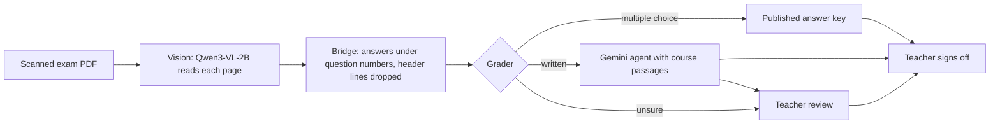

# Group Assignment Report

- **Team** (Blackboard group name): [team name]
- **Section**: [BBADBA 5A | BBADBA 5B | PPLEDBA 5A]
- **Space URL**: [pending: the Space needs a paid account, which our teacher is looking into]
- **Final commit** (tag `final`): [to add when tagged]

## Business case

Our product is for a teacher who has to mark a pile of handwritten exams, and in our case the exam is the Data Science exam of the public Mendeley dataset, which has 35 questions per paper, 20 multiple-choice questions worth one point each and 15 short written answers worth two points each, so 50 points in total. Today the teacher marks every paper by hand, which means checking every letter against the key, reading every written answer, deciding the partial credit and adding up the total, and this is our baseline, because it is what happens if the product doesn't exist. Our product doesn't decide the final mark, it prepares every paper so the teacher only looks carefully at the answers it is not sure about, with the reading, the proposed mark and the reason next to each one, and then signs it off.

We measure success with how many answers still go to the teacher per paper, since that is the work left, and how many proposed marks are wrong, counted as the marks the teacher changes at sign-off, because a wrong mark that nobody catches is much worse for a student than a review, together with the cost and waiting time per paper. We didn't time a teacher marking by hand, so the value is an estimate built on assumptions that we state openly: we are assuming a course of 200 students with three exams a year (600 papers), about 10 minutes of marking per paper and a teacher cost of €40 per hour, which gives 100 hours and €4,000 per course and year. If the product took over the multiple-choice part, which we are assuming is about a third of the marking time, the teacher would save around 33 hours (€1,333) per course and year, while the grading model costs less than one cent per paper (see Cost and latency), so the money is clearly not the problem, the problem is whether the marks can be trusted.

## Architecture

The product chains a vision component that reads the scanned exam and an agentic LLM component that grades it, and the output of the first one is the input of the second one: each answer with its question number, its text and a confidence for the reading and another for the number.

When a teacher uploads a paper, Qwen3-VL-2B, a pretrained vision-language model, reads each whole page line by line, and a line that starts with a question number starts that question. Then the bridge turns that read into the hand-off format and drops the short header lines above the first question, because they are not answers and they can hold the student's name. The grader then checks each multiple-choice letter against the published key, and for each written answer it asks Gemini (gemini-3.1-flash-lite, through LangChain) to propose a mark, but only if it can cite a passage of the course notes for every criterion of the rubric, so a mark always comes with its evidence. Anything the grader is not sure about goes to the teacher, like a low reading confidence, a question found twice, a missing question, a proposed written mark of 1/2 or less, or an answer the provider failed to grade, and no paper has a final total until the teacher signs it off. [reuse from assignments 1–3: team to fill in whose code and where]

## Data

The exams come from "A Dataset of Digitized Student Examination Papers" by Dinesh K P on Mendeley Data (CC BY 4.0), which has 50 scanned exams together with their answer key and the teacher's marks. The reader's choices were made on 126 public handwriting images and its fine-tuning used 1,012 pages, and the grader retrieves from 367 paragraphs of public course notes, with every source, licence and size in [SOURCES.md](SOURCES.md) and [vision/README.md](vision/README.md).

Then we had to be careful with personal data, because the Mendeley marks file has a Student_Name column that is not anonymised, so we drop it when loading, and the files with names and student IDs never enter the repo. Every paper also has the student's name written in a faint header, which is why the bridge drops the lines above the first question, and for the held-out test we also whitened every faint pixel of the pages before anything reached the reader or Gemini. The logs keep counts, versions, times and costs, but no answer text or names.

## Evaluation

### Components

The vision component took most of the project, 20 tries logged in [artifacts/vision/tries.csv](artifacts/vision/tries.csv) and told in seven chapters in [vision/](vision/README.md). We started by training our own YOLO detectors for question numbers and lines, which worked on their own test data (AP50 0.79 and 0.88) but found only 11% of the questions on the real Mendeley exams, because those answer sheets look nothing like the training images. The honest thing we have to say here is that three of our next tries were then tuned on Mendeley exams by mistake, which contaminated them, so we threw them away and from then on the 50 Mendeley exams became evaluation-only, and every choice was made on a separate development set of 126 public images. There Qwen3-VL-2B reading the whole page was clearly best (7.3% character error and 89% of numbers found, against 19 to 28% and 23 to 56% for line readers), but it found only 43% of the numbers on answer sheets, so we fine-tuned it with LoRA, which gave slightly better text but fewer numbers on answer sheets (39%) and 52 proposals against 60 on the 30 cases, so we kept the base reader and froze it.

| Reader on the 50 Mendeley exams (run once, frozen) | Questions found | Letters read | Letters right when read |
|---|---:|---:|---:|
| Our YOLO detectors | 11% | 1% | 56% |
| Line OCR | 27% | 14% | 84% |
| **Qwen3-VL-2B, whole page (chosen)** | **86%** | **82%** | **99%** |
| Qwen3-VL-4B, whole page | 83% | 77% | 99% |

For the grader, multiple choice is simple once the letter is read (987 recorded letters scored by the key, 13 unusable ones referred), so the hard part is the written answers. On the final frozen test, four papers with 56 written answers (manual transcriptions, so the reading can't affect it), the grader proposed 31 marks, and of the 30 we could compare 16 matched the teacher exactly against 7 for a baseline that gives each question its average mark, but its mean error was about the same (0.55 against 0.52 out of 2) and 12 proposals were a point or more below the teacher. That is why we decided to send every proposed written mark of 1/2 or less to the teacher, because most of the big errors were under-awards, and on those papers that turned 45 of 56 written answers into reviews but left only proposals that matched the teacher (10 out of 10). [Four-paper test](eval/written_validation_four.json) · [Review cutoff](eval/written_review_policies.json) · [Other exams](eval/generalization_unt.json)

We checked the LLM judge of the written feedback against 23 labels by Javi (recommended by an AI assistant and then reviewed and approved by him), and it agreed only 13 times (56.5%), mostly passing feedback that Javi failed, and 65% on a second packet of 20, so the judge is too lenient to replace a person, which is one more reason the teacher sees the evidence and not only the mark. [Labels](eval/human_labels.csv) · [Agreement](eval/feedback_agreement.json)

### End to end

We wrote 30 cases in [eval/cases.csv](eval/cases.csv) (12 normal, 8 hard, 7 that should go to review and 3 unrelated uploads like a geography worksheet), most of them with real handwriting cropped from eight Mendeley papers. It is an integration test and not a clean estimate, because those papers were also used in development, and the baseline is a perfect reader that gives full credit to every visible answer.

| 30 cases, final pipeline | Product | Full-credit baseline |
|---|---:|---:|
| Cases fully correct | 23/30 | 14/30 |
| Proposed marks that match the teacher | 65/65 | 44 of the same 65 |
| Large mark errors | 0 | – |
| Answers read exactly | 78/105 | assumed perfect |

The product gets more cases right than the baseline and never proposed a wrong mark, but it gets there by sending a lot to review (32.8 of 35 rows per case, partly because most cases are crops with a few questions). [Results](eval/base_written_review_30/summary.json)

Then we ran the whole product once on five Mendeley exams that no earlier step had used (Students 43, 45, 46, 47 and 50). The first run happened during a Gemini outage, so the written answers couldn't be graded and went to review, and four of the five exams were sent entirely to review because one header line ("Data Science") was left above the first question and the grader refers the whole exam if any line can't be placed. On Student_43, the only exam that got through, all 20 multiple-choice marks matched the teacher. That failure is why we added the header rule to the bridge, which drops lines of up to six words above the first question, and when we measured it on the other 45 Mendeley exams the exams sent entirely to review went from 32 to 14 and the multiple-choice marks proposed went from 190 to 457 (453 exact), with no exam getting worse. We have to disclose that this breaks our own rule, because the fix was written after seeing a test exam fail and measured on evaluation exams, so Student_45 is reported apart and the clean result is the other four exams. [Held-out test](eval/heldout_e2e.py) · [Header rule](eval/header_rule_dev.py)

When we ran the five exams again with Gemini working, the multiple-choice part held up, because on the four clean exams the product proposed 56 marks and the 53 we could compare all matched the teacher, while giving full credit to every answer would have matched only 51 of 77. The written part is where it fell short, because only 2 of the 56 written answers got a proposal (both exact), and when we looked at why, most of the referrals came from the reader and not from Gemini, since 32 of them were a low reading confidence, an uncertain or missing question number or a question found twice, and only 4 were the low-mark or evidence rules and 3 a provider failure. Student_47 went entirely to review again, because one line the reader couldn't place was not a header the rule recognises, which is the same failure as before, so we report it as it is and didn't change anything after seeing it.

| Clean held-out (Students 43, 46, 47, 50) | Product | Full credit | Typical mark |
|---|---:|---:|---:|
| Multiple choice: proposed marks matching the teacher | 53/53 (24 referred) | 51/77 | – |
| Written (without Q32): proposed marks matching the teacher | 2/2 (44 referred) | 37/46 | 7/46 |
| Exams sent entirely to review | 1 of 4 | – | – |
| Median time per exam | 69 s (reader 37 s) | – | – |

Student_45, which is reported apart, got all 20 multiple-choice marks right and 1 written proposal, also exact. [Summary](eval/heldout/summary.json)

### Cost and latency

| Per paper | Tokens | Euros | Seconds |
|---|---:|---:|---:|
| Vision reader (local, Apple GPU) | – | €0 (runs locally) | about 18 per exam |
| Vision reader (free Space, 2 CPU threads) | – | €0 | about 85 per page |
| Grader, one written answer | about 2,300 | about €0.0009 | about 3 |
| Whole paper, measured on the held-out exams | about 5,500 | about €0.002 | about 69 (median, Apple GPU) |

At 600 papers a year the grading costs around €1, so the real cost is the reader's hardware, since on the free Space a four-page exam would take around six minutes and 13 GB of memory, which is why we would run it on a GPU. Prices use $0.30 per million input tokens and $2.50 per million output tokens at USD 1.1127 per EUR on 11 November 2026. [Measured requests](eval/printed_pdf_finalized.json)

## Operations

Every request is logged with the versions, a summary of the input (pages, lines, ink, confidence), each component's output as counts, the time, the tokens, the cost and the teacher's 👍/👎 and sign-off, and the logs go to a private Hugging Face dataset, because a Space loses its disk when it restarts. The Monitoring tab shows the share of answers sent to review and the share of 👎 over time as the quality signals, and the drift check compares five input signals of recent papers with a reference set of 30 papers using the population stability index (PSI), which measures how much a distribution moved. The alert fires when a signal goes above 0.25 or twice the noise we would expect by chance for that number of papers, whichever is larger, because with few papers per window a fixed threshold fired too often (54 of 100 ordinary windows without smoothing, against 1 of 100 after adding half an observation per bin).

For the drift demo we faded ten scans on purpose, as if a scanner lost contrast, and the alert fired on them and stayed quiet on the 12 normal scans.

| Signal | Normal PSI (threshold 0.933) | Faded PSI (threshold 1.067) |
|---|---:|---:|
| Mean reading confidence | 0.753 | **1.561** |
| Number of readings | 0.035 | **2.185** |
| Unassigned answers | 0.023 | 0.027 |
| Ink density | 0.359 | **1.948** |
| Number of lines | 0.138 | **3.490** |

One normal and one faded window can't give us a real false-alarm rate, and the live tab waits for 20 papers before it judges drift. [Drift results](eval/base_reader_drift.json)

## Failures

The 7 failed cases out of 30 were mostly the reader, because 6 of them came from the vision component and only 1 from the grader, and none of the 7 ended with a wrong mark, they were all sent to review when a mark was expected or read in a way the case didn't allow. The reader missed ten question numbers on a two-column sheet (c13), read 31 as 34 and 22 as 26 on two written answers (c17 and c25), misread an empty answer box (c12), didn't separate a letter from the same option written in words (c15) and wasn't sure enough of a faint question number to place a written answer the teacher gave 1.5/2 (c19). The grader sent one readable answer the teacher gave 2/2 to review (c18), because it couldn't cite a course passage for one of the two criteria of the rubric. On full exams the main failure was the hand-off, where one line the reader couldn't place sends all 35 questions to review (Student_47). The first thing we would fix is the reader's question numbers, because a wrong number moves a correct answer under the wrong question, and confidence can't catch it (the median confidence is 1.00 for right letters and 0.999 for wrong ones).

We also tried referring only the questions a loose line could belong to instead of the whole exam, but on 150 Roboflow answer pages the pages where it would release questions had extra question numbers 73% of the time against 34% on normal pages (mostly numbered lists inside answers), so it was not safe and we removed it.

## Decision

The rule that sends answers to the teacher is the following: a multiple-choice letter is proposed only if it is read with at least 0.80 confidence and it is a valid option, a written answer is proposed only if every criterion has a cited passage and the proposed mark is above 1/2, and anything else, like a missing or repeated question, a line that can't be placed, a question that needs its figure or a provider failure, goes to the teacher, who also signs off every paper. On the 45 exams of the header-rule check a median of 20 of 35 answers per paper went to the teacher, most of them written, so with 200 papers marked over a week (40 a day) that would be about 800 answers a day to review and 40 sign-offs.

Our decision is **go with conditions**, because the product can take the multiple-choice part off the teacher's hands, where the marks it proposed matched the teacher almost every time (65/65 on the 30 cases and 453 of 457 on the header-rule check), while the written part is still mostly reviewed. The clean held-out rerun supports this, with 53 of 53 multiple-choice proposals right and only 2 written proposals. The conditions are that every paper is signed off by a teacher, that the reader's question numbers improve before the written part can save real time, that the reader runs on a GPU so a paper takes about a minute and not six, and that before selling it to a school we time the teachers marking with and without it, because a product that still sends more than half of the answers to the teacher is hard to sell if it doesn't save them time. It is a no-go for grading without a teacher, because the written marks are not good enough and confidence doesn't catch the reader's mistakes.

## Bonus: reinforcement learning

We added a bandit that learns the written review rule from the teacher's corrections, which is one of the examples in the brief, and it chooses for each paper between three rules: sending to the teacher only the written answers the grader is unsure about, also every proposed 0/2, or also every proposed mark of 1/2 or less, which is the rule we used before. Our first version chose the reader's confidence threshold (0.70 to 0.95), but the reader is almost always above 0.95, so every threshold sent the same answers to review and there was nothing to learn, which is why we moved it to a decision that visibly changes what the teacher sees. The loop closes at sign-off, when the app computes the reward, logs it with the rule used and draws the next paper's rule from the updated estimates. The reward is minus the teacher's cost per answer, counting each review as 1 and each proposal the teacher changed as 5, because a wrong mark costs the time to spot it plus the risk that nobody does, and it arrives when the paper is signed off, which can be hours or days after the upload.

We explore with Thompson sampling, because it keeps an estimate of each rule's cost with its uncertainty and draws from it, so a clearly worse rule is almost never played, and the cost of exploring falls on the teacher, who gets more pre-filled written marks to check, never on a mark that skips sign-off. Before any real traffic each rule starts from a simulator with written-down assumptions (60% of Gemini's proposals exact, 30% half a point off and 10% a whole point off), not from exams, and it counts as at most five papers per rule, so a few real sign-offs overrule it. The simulator expects the strictest rule to be cheapest (0.54 per answer against 0.64 and 0.65), because a let-through mark that is wrong 40% of the time costs two reviews on average. **[Real part: results of the team's sign-off sessions in the app to add]** The main risk is reward hacking, because a teacher who signs off without reading changes nothing, so a lenient rule would look free and the bandit would learn to send less to review exactly when nobody is checking. Then only the teachers who use the app give feedback, the rule it plays most is the one it ends up knowing best (a feedback loop), and the reward depends on the cost of 5 we chose, since below about 1.5 the lenient rules would win. [Bandit](exam_grader/bandit.py) · [Simulator](eval/bandit_simulator.py)

## How to run it

Follow [SETUP.md](SETUP.md), and then `uv run --locked --no-dev python app.py` starts the app at http://127.0.0.1:7860. The sample paper runs without any key, and a GEMINI_API_KEY in `.env` turns on the written grading. The first run downloads the Qwen3-VL-2B reader (about 4 GB) from Hugging Face, and a paper takes about 18 seconds on an Apple GPU and much longer on a CPU.

## AI use

We used AI assistants for code. Codex helped with the grading component, the test harnesses, the rubric and retrieval experiments and the evaluation tooling, and Claude helped with the vision chapters, the integration, the app redesign, the bandit, the evaluation scripts and the first draft of this report, which we then checked and rewrote. The decisions in the report are ours, like the problem, the review rule, the cost of a wrong mark, the drift threshold and keeping the Mendeley exams for evaluation, and Javi's feedback labels were recommended by an AI assistant and then reviewed and approved by him. [each member to add their own AI use]
