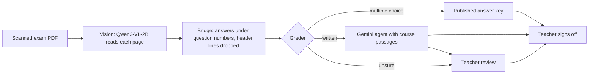

# Group Assignment Report

- **Team** 3: Javier Sanchez, Sarah-Marie Coste, Paula Candiles, Lucia Bell, Javier Lopez, Anna Serra
- **Section**: BBADBA 5B 
- **App URL** (on Render): https://daiist-exam-grader.onrender.com
- **Final commit** (tag `final`): [to add when tagged]

## Business case

Our product is for a teacher who has a pile of handwritten exams to mark, and in our case that exam is the Data Science exam of the public Mendeley dataset, which has 35 questions per paper, 20 multiple-choice questions worth one point each and 15 short written answers worth two points each, so 50 points in total. Today the teacher marks every paper by hand, checking every letter against the key and reading every written answer to decide the partial credit, and this is our baseline, because it is what happens if our product doesn't exist. Our idea was never to replace the teacher, so the product doesn't decide the final mark, it prepares every paper so the teacher only looks carefully at the answers it isn't sure about, with what it read, the proposed mark and the reason next to each one, and then the teacher signs the paper off.

We measure success with two things, how many answers still go to the teacher per paper, since that is the work that is left, and how many proposed marks are wrong, counted as the marks the teacher changes at sign-off, because a wrong mark that nobody catches is much worse for a student than one more review. We also look at the cost and the waiting time per paper. We didn't time a real teacher marking by hand, so the value in euros is an estimate built on four assumptions that we state openly: a course of 200 students with three exams a year (600 papers), about 10 minutes of marking per paper, a teacher cost of €40 per hour, and the multiple-choice part being about a third of that marking time. That gives 100 hours and €4,000 per course and year, and if the product took over the multiple-choice part the teacher would save around 33 hours (€1,333), while the grading model costs less than one cent per paper (see Cost and latency), so money is clearly not the problem, the problem is whether the teacher can trust the marks.

## Architecture

The product has two parts connected one after the other, a vision part that reads the scanned exam and an agentic LLM part that grades it, because first we need to know what the student wrote and only then we can decide if it is right. The output of the first part is the input of the second one, which is a list of answers, each one with its question number, its text and two confidences, one for the reading and one for the number.

So when a teacher uploads a paper, this is what happens. First Qwen3-VL-2B, a pretrained vision language model (a model that looks at an image and writes the text it sees), reads each whole page line by line, and every line that starts with a question number starts that question. Then a small bridge turns that reading into the hand-off format and drops the short header lines above the first question, because they aren't answers and they can have the student's name in them. Then the grader takes over, and for the multiple-choice questions it just checks the letter against the published key, while for each written answer it asks Gemini (gemini-3.1-flash-lite, through LangChain) to propose a mark, but only if it can cite a passage of the course notes for every point of the rubric, so a mark always comes with its evidence. We chose Qwen because it was clearly the best reader on our public test pages and it is small enough to run on a laptop, and Gemini because it is cheap and it can use tools, which is what lets it look up passages before deciding. Whenever the grader isn't sure, like with a low reading confidence, a question found twice, a missing question, a proposed written mark of 1/2 or less or an answer the provider failed to grade, the answer goes to the teacher, and no paper gets a final total until the teacher signs it off. [reuse from assignments 1–3: team to fill in whose code and where]

## Data

The exams come from "A Dataset of Digitized Student Examination Papers" by Dinesh K P on Mendeley Data (CC BY 4.0), which has 50 scanned exams together with their answer key and the teacher's marks. Over the 20 tries of the reader and all the work on the grader we used a lot more data than that though, so the table below lists every dataset and where we used it, because it is the easiest way to see that the reader's choices were made on public handwriting and not on the exams we evaluate on (the only exception is the mistake in tries 6 to 8, which we explain in Evaluation). The try numbers are the ones in [artifacts/vision/tries.csv](artifacts/vision/tries.csv), and the links and download steps are in [vision/README.md](vision/README.md) and [SOURCES.md](SOURCES.md).

| Data | Licence | Size | Where we used it |
|---|---|---|---|
| Roboflow answer-sheet component detection v1 | CC BY 4.0 | 576 pages from 8 booklets | Training and testing our YOLO question-number detector (tries 1 and 3), 21 pages in the development set (tries 11 to 20), and 150 pages to test the targeted rule we removed |
| Roboflow handwritten text line dataset v1 | CC BY 4.0 | 1,280 photos | Training and testing our YOLO line detector (tries 2 and 3) |
| Gazi University question boxes and four other Roboflow sets | not checked | looked at only | Search for public data with handwritten question numbers (try 5), none of it was usable |
| SMHD, Student Messy Handwritten Dataset (RMIT) | CC BY-NC 4.0 | 39 pages | Development set, to choose the reader and its rules (tries 11 to 14 and 20) |
| Handwritten ASAP-SAS (Gold and Zesch 2020) | non-commercial research | 40 answers | Development set (tries 11 to 14 and 20) |
| School Notebooks EN (ai-forever) | MIT | 12 photos | Development set (tries 17 and 20) |
| Short and blank pages made by us | ours | 14 pages | Development set, mainly for the blank-page rule (try 14) |
| GNHK (Lee, Chung and Lee 2021) | CC BY 4.0 | 673 pages (512 training, 161 validation) | Fine-tuning the reader with LoRA (tries 18 and 19) |
| Synthetic exam pages from OpenHand-Synth and EMNIST | CC BY 4.0 | 600 pages (500 training, 100 validation) | Fine-tuning the reader with LoRA (tries 18 and 19) |
| Mendeley digitized exam papers (Dinesh K P) | CC BY 4.0 | 50 exams, answer key and teacher marks | Evaluating the reader once frozen (tries 4, 15 and 16), and by mistake developing it on 11 exams (tries 6 to 8). Also the grader's multiple-choice replay and written tests on transcriptions, the Q32 rule (all 50), the 30 integration cases (crops of 8 papers), the drift reference (30 crops) and faded scans, the header-rule measurement (45 exams) and the held-out test (5 exams) |
| Course notes: Google Machine Learning Education, scikit-learn User Guide, Wikipedia and 7 study notes we wrote | Google education terms, BSD, CC BY-SA 4.0 and ours | 367 paragraphs from 25 pages | The retrieval index the grader cites for every written mark |
| UNT computing exams (Mohler, Bunescu and Mihalcea 2011) | public research release | answers to 8 prompts | Testing the grader on other subjects and on new questions |
| Physics course and exam made by us | ours | 1 course PDF, 2 questions, 6 answers | Engineering check of a teacher loading their own exam |
| Our feedback labels (Javi) | ours | 23 and 20 labels | Checking the LLM judge of the written feedback |

Then we had to be careful with personal data, because the Mendeley marks file has a Student_Name column that isn't anonymised, so we drop it when loading and the files with names and student IDs never enter the repo. Every paper also has the student's name written in a faint header, which is why the bridge drops the lines above the first question, and for the held-out test we also whitened every faint pixel of the pages before anything reached the reader or Gemini. On top of that, only the PDFs we checked are de-identified can have their written answers sent to Gemini, and the logs keep counts, versions, times and costs, but never answer text or names.

## How we got here

This section tells how we got to the product, because the final pipeline only makes sense once you see what we tried before, what didn't work and why. We built the two parts in parallel, Anna the reader and Javi the grader, and then we put them together, so we tell each story in that order.

### The reader: from our own detectors to a page reader

Our first idea was the classic one, finding the question numbers and the lines with detectors and then reading each line with an OCR model. So we trained two YOLO detectors on public Roboflow data, one for question numbers and one for text lines, after trying a grid of settings for each (7 runs and 4 runs), and on their own test data they worked well (AP50 of 0.79 and 0.88), while a version with simple rules and no learning got almost nothing (0.00 and 0.19), so training was clearly needed (tries 1 to 3). The problem came when we ran the first reader on the Mendeley exams, because it found only 10.9% of the questions, and the question-number detector never went above 0.006 confidence on a Mendeley page, since all its training pages came from one single source that looks nothing like our exams (try 4). We looked for other public data with handwritten question numbers, but the only candidate, a Gazi University set, turned out to be printed Turkish test books, and the others label whole regions or bubbles instead of the numbers (try 5).

Then we made the mistake we already mentioned in Data. To improve the reader we tried four versions of reading the number from the start of each line (from 13.5% up to 25.6% of questions found) and compared bigger readers (TrOCR base 25.6%, TrOCR large 34.3%, Qwen3-VL-2B on lines 46.1% and Qwen3-VL-2B on the whole page 90.8%). The page reader was clearly the best, but it invented about 40 numbers per exam on blank pages, so we added safeguards against that, and the problem is that we did all of it on 11 Mendeley exams, which are supposed to be only for evaluation (tries 6 to 8). That is why we threw those choices away, built a development set of 114 public images (later 126) and decided everything again there, and it was a good thing we did, because the blank-page threshold we had picked on Mendeley would have skipped real pages written with a light pen.

On the development set the result was clear. Qwen3-VL-2B reading the whole page had 7.3% character error and found 89% of the numbers, against 18.9% to 27.6% error and 23% to 56% of numbers for the line readers, and the bigger 4B model read a bit better (6.5%) but found fewer numbers (85%) and was twice as slow, so we chose the 2B (try 11). Then we tuned it there too. Plain greedy decoding invented 703 lines on short and blank pages, so we added a small repetition penalty (1.05), which brought that down to 12 without hurting the text (try 12), and of the four rules we tried for question numbers only the one that removes a stray mark before the number helped (89% found against 84%, try 13). We also set the blank-page threshold at half the ink of the lightest written page (try 14), and checked that the reader could run on a free CPU server, which it can, but at 85 seconds a page and 13.3 GB of memory (try 10). Only then we froze it and read the 50 Mendeley exams once, and it found 86.2% of the questions and read 81.4% of the multiple-choice letters right (98.9% when it read one), while the 4B model confirmed the choice with 83.4% and 76.0% (tries 15 and 16).

The weak point left was the answer sheets, where the reader found only 43% of the numbers, so we tried fine-tuning it. We built training data from 673 real GNHK pages and synthetic exam pages, with nothing from Mendeley or the development set (try 18), and trained a LoRA adapter, which is a small add-on trained on top of the model instead of retraining the whole model (try 19). The first run filled the 48 GB of the Mac and was stopped with nothing saved, because freed memory stayed in the GPU cache, so after fixing that we trained it on an NVIDIA RTX 5080 in 19 minutes. It learnt something, since the validation loss dropped (GNHK 1.03 to 0.62) and the text got slightly better (SMHD 7.2% to 6.7% error), but on answer sheets, the pages closest to our exams, it found fewer numbers (39% against 43%), and later on the 30 test PDFs it made 52 proposals against 60 for the base reader, so we kept the base reader and left the adapter as an option (try 20). [All 20 tries](artifacts/vision/tries.csv) · [The seven chapters](vision/README.md) · [Base against LoRA on 30 PDFs](eval/base_vs_lora_30/summary.json)

### The grader: from a strict pilot to a grader that knows when to stop

Multiple choice was simple from the start, because once a letter is read it just has to be compared with the published key, and on the 1,000 recorded answers of the 50 exams 987 got the score the key implies and the 13 unusable ones went to review. [Replay](eval/published_mcq_replay.json) The written answers were the real work, and the first thing was finding the right passages in the course notes. We started with a word-matching search (lexical) and improved it over three versions, and in the third one the right page appeared in the first three results for 11 of the 14 answerable questions, up from 9 in the second, and then we built two semantic indexes, which search by meaning with embeddings, and with those the right page was in the first three results for all 14, and first for all 14 when we split the notes by paragraph. Q34 can't be graded from text at all, since it needs the original figure. [Lexical](eval/written_retrieval_lexical_v3.json) · [Semantic](eval/written_retrieval_semantic.json)

Then came the rubric. Our first written rubric didn't match the teacher well, so we rewrote it so a complete answer gets the two points and every deduction has to be explained, and on the two pilot papers the exact matches with the teacher went from 3 to 6 and the mean error from 0.96 to 0.71 points. On two fresh papers we then saw that our first confidence threshold (0.40) was too strict, because it proposed only 2 marks, so we moved it to 0.25, which gave 8 proposals with 4 exact and a mean error of 0.375, against 0.5625 for a baseline that gives each question its average mark. [Pilot](eval/written_rubric_v2_pilot.json) · [Fresh papers](eval/written_rubric_v2_fresh.json) The test on four unseen papers (in Evaluation) showed the main problem, which is that the big errors were almost always the grader giving too little, so we compared two review rules, sending proposed zeros to the teacher (39 of 56 answers reviewed, 13 of 16 proposals exact) or every proposal of 1/2 or less (45 of 56 reviewed, 10 of 10 exact), and we chose the second one, because we prefer more reviews to a low mark nobody checks. [Review rules](eval/written_review_policies.json)

Some questions needed their own rule. Q32 asks for hyperparameters and the teachers gave partial credit in ways we couldn't turn into a rule, since naming a list of algorithms got 1/2 on some papers and 0/2 on others, so the grader only proposes clear cases and sends the rest to the teacher, which on the 50 exams means 45 reviews and 5 proposals, and the 4 we could compare all matched the teacher. [Q32](eval/q32_all50_svm_only.json) We also checked the plan's other baseline, giving the scan directly to Gemini, on printed answers, and both read the answers right, but the direct version gave 0 to an invalid choice that our pipeline correctly sent to review, while being faster (1.99 against 6.15 seconds). [Direct baseline](eval/printed_direct_baseline.json) For the feedback judge, checking each claim against the quoted passages halved the false passes (10 to 5) but added 4 false fails, which together with the 56.5% agreement with Javi's labels is why we don't trust it to replace a person. [Judge](eval/q22_routing_and_judge_replay.json) Last, we checked that the grader isn't only good at our exam, and on two computing questions from another university it proposed 7 of 8 answers, 4 exactly right and all 7 within half a point. [Other exams](eval/generalization_unt.json)

### Putting them together

When we joined the reader and the grader, we wrote the 30 test cases and found that most failures were in between, in the hand-off. Our first drift alert fired on 54 of 100 ordinary windows, so we smoothed it (Operations), the first held-out run showed that one header line could send a whole exam to review, so we added the header rule, a more targeted fix for loose lines turned out unsafe, so we removed it (Failures), and the bandit's first version chose a reading threshold that changed nothing, so we moved it to the written review rule (Bonus). Last came deployment, which we planned for a Hugging Face Space, but Hugging Face started asking for a paid plan to create Gradio Spaces, so the course moved to Render, where the reader doesn't fit in memory and we had to precompute its readings for the demo exams (Operations).

## Evaluation

### Components

The reader is the frozen Qwen3-VL-2B page reader we chose in How we got here, and the table shows all the readers we built, each one run once on the 50 Mendeley exams, which is why we trust the 86% and not a number we tuned for.

| Reader on the 50 Mendeley exams (run once, frozen) | Questions found | Letters read | Letters right when read |
|---|---:|---:|---:|
| Our YOLO detectors | 11% | 1% | 56% |
| Line OCR | 27% | 14% | 84% |
| **Qwen3-VL-2B, whole page (chosen)** | **86%** | **82%** | **99%** |
| Qwen3-VL-4B, whole page | 83% | 77% | 99% |

For the grader, multiple choice is simple once the letter is read (987 recorded letters scored by the key, 13 unusable ones referred), so the hard part is the written answers. On the final frozen test, four papers with 56 written answers that were transcribed by hand, so the reading can't affect the result, the grader proposed 31 marks, and of the 30 we could compare 16 matched the teacher exactly against 7 for a baseline that gives each question its average mark. Its mean error was about the same though (0.55 against 0.52 out of 2), and 12 proposals were a point or more below the teacher, so most of the big errors were the grader giving too little. That is why we decided to send every proposed written mark of 1/2 or less to the teacher, and on those papers that turned 45 of 56 written answers into reviews but left only proposals that matched the teacher (10 out of 10). [Four-paper test](eval/written_validation_four.json) · [Review cutoff](eval/written_review_policies.json) · [Other exams](eval/generalization_unt.json)

We also checked the LLM judge of the written feedback against 23 labels by Javi (recommended by an AI assistant and then reviewed and approved by him), and it agreed only 13 times (56.5%), mostly passing feedback that Javi failed, and 65% on a second packet of 20, so the judge is too lenient to replace a person, which is one more reason why the teacher sees the evidence and not only the mark. [Labels](eval/human_labels.csv) · [Agreement](eval/feedback_agreement.json)

### End to end

We wrote 30 cases in [eval/cases.csv](eval/cases.csv), 12 normal, 8 hard, 7 that should go to review and 3 unrelated uploads like a geography worksheet, most of them with real handwriting cropped from eight Mendeley papers. For example c01 is five multiple-choice answers in a row with right and wrong letters, which should all get a mark, and an unrelated worksheet should be rejected and not graded. It is an integration test and not a clean estimate, because those papers were also used in development, and the baseline is a perfect reader that gives full credit to every visible answer.

| 30 cases, final pipeline | Product | Full-credit baseline |
|---|---:|---:|
| Cases fully correct | 23/30 | 14/30 |
| Proposed marks that match the teacher | 65/65 | 44 of the same 65 |
| Large mark errors | 0 | – |
| Answers read exactly | 78/105 | assumed perfect |

The product gets more cases right than the baseline and never proposed a wrong mark, but it gets there by sending a lot to review (32.8 of 35 rows per case, partly because most cases are crops with only a few questions). [Results](eval/base_written_review_30/summary.json)

Then we ran the whole product once on five Mendeley exams that no earlier step had used (Students 43, 45, 46, 47 and 50). The first run happened during a Gemini outage, so the written answers couldn't be graded and went to review, and four of the five exams were sent entirely to review because one header line ("Data Science") was left above the first question, and the grader refers the whole exam if any line can't be placed. On Student_43, the only exam that got through, all 20 multiple-choice marks matched the teacher. That failure is why we added the header rule to the bridge, which drops lines of up to six words above the first question, and when we measured it on the other 45 Mendeley exams the exams sent entirely to review went from 32 to 14 and the multiple-choice marks proposed went from 190 to 457 (453 exact), with no exam getting worse. We have to say openly that this breaks our own rule, because the fix was written after seeing a test exam fail and measured on evaluation exams, so Student_45 is reported apart and the clean result is the other four exams. [Held-out test](eval/heldout_e2e.py) · [Header rule](eval/header_rule_dev.py)

When we ran the five exams again with Gemini working, the multiple-choice part held up, because on the four clean exams the product proposed 56 marks and the 53 we could compare all matched the teacher, while giving full credit to every answer would have matched only 51 of 77. The written part is where it fell short, because only 2 of the 56 written answers got a proposal (both exact), and when we looked at why, most of the referrals came from the reader and not from Gemini, since 32 of them were a low reading confidence or a problem with the question number, and only 4 were the low-mark or evidence rules and 3 a provider failure. Student_47 went entirely to review again, because one line the reader couldn't place wasn't a header the rule recognises, so it is the same failure as before, and we report it as it is without changing anything after seeing it.

| Clean held-out (Students 43, 46, 47, 50) | Product | Full credit | Typical mark |
|---|---:|---:|---:|
| Multiple choice: proposed marks matching the teacher | 53/53 (24 referred) | 51/77 | – |
| Written (without Q32): proposed marks matching the teacher | 2/2 (44 referred) | 37/46 | 7/46 |
| Exams sent entirely to review | 1 of 4 | – | – |
| Median time per exam | 69 s (reader 37 s) | – | – |

Student_45, which is reported apart, got all 20 multiple-choice marks right and 1 written proposal, also exact. [Summary](eval/heldout/summary.json)

### Cost and latency

| Per paper | Tokens | Euros | Seconds |
|---|---:|---:|---:|
| Vision reader (local, Apple GPU) | – | €0 (runs locally) | about 18 per exam |
| Vision reader (free CPU server, 2 threads) | – | €0 | about 85 per page |
| Grader, one written answer | about 2,300 | about €0.0009 | about 3 |
| Whole paper, measured on the held-out exams | about 5,500 | about €0.002 | about 69 (median, Apple GPU) |

At 600 papers a year the grading costs around €1, so the real cost is the reader's hardware, because on a free CPU server a four-page exam would take around six minutes and 13 GB of memory, which is why in a real school we would run it on a GPU. Prices use $0.30 per million input tokens and $2.50 per million output tokens at USD 1.1127 per EUR on 11 November 2026. [Measured requests](eval/printed_pdf_finalized.json)

## Operations

Every request is logged with the versions, a summary of the input (pages, lines, ink and confidence), each part's output as counts, the time, the tokens, the cost and the teacher's 👍/👎 and sign-off. Online the logs go to the free Postgres database that Render creates with the app, because the app loses its disk every time it restarts or goes to sleep, and on a laptop they go to the logs folder. The Monitoring tab shows the share of answers sent to review and the share of 👎 over time as our quality signals, and the drift check compares five input signals of the recent papers with a reference set of 30 papers using the population stability index (PSI), which tells us how much a distribution moved. The alert fires when a signal goes above 0.25 or above twice the noise we would expect just by chance for that number of papers, whichever is larger, because with few papers per window a fixed threshold fired too often (54 of 100 ordinary windows without smoothing, against 1 of 100 after adding half an observation to every bin).

For the drift demo we faded ten scans on purpose, as if a scanner was losing contrast, and the alert fired on them and stayed quiet on the 12 normal scans.

| Signal | Normal PSI (threshold 0.933) | Faded PSI (threshold 1.067) |
|---|---:|---:|
| Mean reading confidence | 0.753 | **1.561** |
| Number of readings | 0.035 | **2.185** |
| Unassigned answers | 0.023 | 0.027 |
| Ink density | 0.359 | **1.948** |
| Number of lines | 0.138 | **3.490** |

One normal and one faded window can't give us a real false-alarm rate though, which is why the live tab waits for 20 papers before it judges drift. [Drift results](eval/base_reader_drift.json)

Then there is where the app runs. The online app is on Render's free plan, which only has 512 MB of memory, and our reader needs several GB just to load the model, so it can't run there, which is why we precomputed its outputs, as the course allows for the cases shown in the demo. We ran the frozen reader on a laptop on the 30 test PDFs and the five held-out exams and saved what it read for each one, named by the PDF's fingerprint (its SHA-256) and the reader version, so a reading from an older reader is never used. Online, uploading one of those PDFs uses its saved reading while the grader still runs live with Gemini, and any other PDF gets a message saying that new exams can only be read on a laptop, so the online app shows the real product on the demo exams but can't read a new exam a teacher uploads. On a laptop it can, because there the reader is installed and runs on every PDF like in our evaluation, and the logs always say which reading was precomputed, since its reader version ends in /precomputed. [Precomputed readings](exam_grader/precomputed.py)

## Failures

The 7 failed cases out of 30 were mostly the reader, because 6 of them came from the vision part and only 1 from the grader, and none of the 7 ended with a wrong mark, they were all sent to review when a mark was expected or read in a way the case didn't allow. The reader missed ten question numbers on a two-column sheet (c13), read 31 as 34 and 22 as 26 on two written answers (c17 and c25), misread an empty answer box (c12), didn't separate a letter from the same option written in words (c15) and wasn't sure enough of a faint question number to place a written answer the teacher gave 1.5/2 (c19). The grader sent one readable answer that the teacher gave 2/2 to review (c18), because it couldn't cite a course passage for one of the two points of the rubric. On full exams the main failure was the hand-off, where one line the reader can't place sends all 35 questions to review (Student_47). The first thing we would fix is the reader's question numbers, because a wrong number moves a correct answer under the wrong question, and the confidence can't catch it, since the median confidence is 1.00 for right letters and 0.999 for wrong ones.

We also tried sending to review only the questions a loose line could belong to, instead of the whole exam, but on 150 Roboflow answer pages the pages where it would let questions through had extra question numbers 73% of the time against 34% on normal pages (mostly numbered lists inside answers), so it wasn't safe and we removed it.

## Decision

The rule that sends answers to the teacher is the following. A multiple-choice letter is proposed only if it is read with at least 0.80 confidence and it is a valid option, a written answer is proposed only if every point of the rubric has a cited passage and the proposed mark is above 1/2, and anything else goes to the teacher, like a missing or repeated question, a line that can't be placed, a question that needs its figure or a provider failure, and the teacher also signs off every paper. On the 45 exams of the header-rule check a median of 20 of 35 answers per paper went to the teacher, most of them written, so with 200 papers marked over a week (40 a day) that would be about 800 answers a day to review and 40 sign-offs.

Our decision is **go with conditions**, because the product can take the multiple-choice part off the teacher's hands, where the marks it proposed matched the teacher almost every time (65/65 on the 30 cases and 453 of 457 on the header-rule check), while the written part is still mostly reviewed, and the clean held-out rerun says the same, with 53 of 53 multiple-choice proposals right and only 2 written proposals. The conditions are four: every paper is signed off by a teacher, the reader's question numbers improve before the written part can save real time, the reader runs on a GPU so a paper takes about a minute and not six, and before selling it to a school we time the teachers marking with and without it, because a product that still sends more than half of the answers to the teacher is hard to sell if it doesn't actually save them time. It is a no-go for grading without a teacher, because the written marks aren't good enough yet and the confidence doesn't catch the reader's mistakes.

## Bonus: reinforcement learning

We added a bandit that learns the written review rule from the teacher's corrections, which is one of the examples in the brief. For each paper it chooses how strict to be with the written answers, going from sending to the teacher only the ones the grader is unsure about up to also sending every proposed mark of 1/2 or less, which is the rule we used before, with a rule in between that also sends every proposed 0/2. Our first version chose the reader's confidence threshold (0.70 to 0.95), but the reader is almost always above 0.95, so every threshold sent the same answers to review and there was nothing to learn, which is why we moved it to a decision that visibly changes what the teacher sees. The loop closes at sign-off, when the app logs the reward with the rule that was used, and the next paper's rule is then picked from the updated estimates. The reward is minus the teacher's cost per answer, counting each review as 1 and each proposal the teacher had to change as 5, because a wrong mark costs the time to spot it plus the risk that nobody does, and it only arrives when the paper is signed off, which can be hours or days after the upload.

We explore with Thompson sampling, which keeps an estimate of how much each rule costs together with how unsure it is, and draws from those estimates, so a rule that is clearly worse is almost never played, and the cost of exploring falls on the teacher, who gets more pre-filled written marks to check, never on a mark that skips sign-off. Before any real traffic each rule starts from a simulator with assumptions we wrote down (60% of Gemini's proposals exact, 30% half a point off and 10% a whole point off) and not from exams, and it counts as at most five papers per rule, so a few real sign-offs overrule it. The simulator expects the strictest rule to be the cheapest (0.54 per answer against 0.64 and 0.65), because a let-through mark that is wrong 40% of the time costs two reviews on average. **[Real part: results of the team's sign-off sessions in the app to add]** The main risk is reward hacking, because a teacher who signs off without reading changes nothing, so a lenient rule would look free and the bandit would learn to send less to review exactly when nobody is checking. Then only the teachers who use the app give feedback, and the rule it plays the most ends up being the one it knows best (a feedback loop), and the whole thing depends on the cost of 5 we chose, since below about 1.5 the lenient rules would win. [Bandit](exam_grader/bandit.py) · [Simulator](eval/bandit_simulator.py)

## How to run it

The online app is at https://daiist-exam-grader.onrender.com, and there, as we explained in Operations, the reader's outputs are precomputed for the 30 test PDFs in eval/inputs and the five held-out exams in eval/heldout/inputs, so those are the ones to upload. Remember that it goes to sleep after 15 minutes without visits and takes about a minute to wake up.

To run the whole product on a laptop, follow [SETUP.md](SETUP.md), so uv sync and then uv run python app.py, which starts the app at http://127.0.0.1:7860. uv sync installs the reader too, because its packages (torch, transformers, peft and ultralytics) are in their own group called reader, which uv installs by default on a laptop but which render.yaml skips with uv sync --no-default-groups, since they don't fit online. The first PDF downloads the Qwen3-VL-2B reader from Hugging Face (about 4 GB), and then a paper takes about 18 seconds on an Apple GPU and much longer on a CPU.

In .env there are two keys that matter. GEMINI_API_KEY turns on the written grading, and without it every written answer goes to the teacher, though the multiple-choice part and the sample paper still work. Then GRADE_APPROVED_HASHES lists the fingerprints of the de-identified PDFs whose written answers may be sent to Gemini, because we only send answers from files we checked have no names in them, and for example the test PDF c06 is ff35ee20848842d1d4e76031eceb282582cb30a217d21c9e654f18b360caeb73, while on Render the same value goes in the service's Environment page. If you want the laptop to behave like the online app, to test that path, you can set GRADE_READER=precomputed, and if the reader ever changes, the saved readings have to be made again with uv run python -m exam_grader.precomputed eval/inputs/*.pdf eval/heldout/inputs/*.pdf. The other commands are the course ones, uv run python main.py with reference, evaluate, drift-demo or export-logs (which copies the online logs to the laptop), and uv run python check.py, which checks everything the way the professor will.

## AI use

We used AI assistants for code. Codex helped with the grading part, the test harnesses, the rubric and retrieval experiments and the evaluation tooling, and Claude helped with the vision chapters, the end to end app, the bandit, the evaluation scripts and the first draft of this report, which we then checked and rewrote. The decisions in the report are ours, like the problem, the review rule, the cost of a wrong mark, the drift threshold and keeping the Mendeley exams for evaluation, and Javi's feedback labels were recommended by an AI assistant and then reviewed and approved by him. [each member to add their own AI use]
