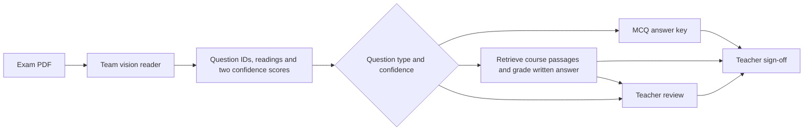

# Group Assignment Report

- **Team** (Blackboard group name):
- **Section**: [BBADBA 5A | BBADBA 5B | PPLEDBA 5A]
- **Space URL**:
- **Final commit** (tag `final`):

*At most about 3,000 words, tables excluded. Members and who did what go in CONTRIBUTIONS.md.*

## Business case

*Who uses it, which decision or task it supports, what happens today without it (the baseline), the success metric, and a rough value in euros with the assumptions behind it.*

## Architecture

*The two components and how one feeds the other: a diagram plus a short walk-through of one request from input to output. Which models or APIs, and why those. What you reused from assignments 1–3, and whose it was.*

The Component 2 interface accepts a versioned handoff. On the bundled engineering example, Q1 contains a clear B, which earns a proposed 1. Q17 contains D on a two-option question and goes to review. The teacher sees the readings, proposed marks, reasons and evidence. A final sheet requires the teacher to complete all 35 marks. The PDF route awaits acceptance with Anna's reader. [Handoff and acceptance procedure](HANDOFF.md)

## Data

*Where each component's data comes from, with links, licences and sizes. Confirm that there is no personal data in your inputs or logs.*

The answer catalogue contains 20 multiple-choice and 15 written questions. Recorded teacher marks are used for evaluation. The public teaching index contains 367 paragraphs from 25 pages, also grouped into 157 section chunks. Precomputed Gemini embeddings allow local retrieval. Student text is used locally for lexical matching. External grading requires a server-approved input. Safe request logs omit answer text, filenames and model feedback. [Dataset, licences and attribution](SOURCES.md)

## Evaluation

### Components

*Each component on its own: the metric, the result, the test data and its size.*

| Component 2 measurement | Observed result | Scope |
|---|---|---|
| MCQ key replay | 987/987 valid letters scored according to the key. All 13 unusable entries went to review. | 50 papers, 1,000 recorded slots, transcription assumed correct. The teacher total agreed on 13/44 complete sheets. [MCQ evidence](eval/published_mcq_replay.json) |
| Retrieval | Approved page in top three for 14/14 answerable written questions with both semantic designs. Lexical search reached 11/14 for sections and 10/14 for paragraphs. | Question-only queries on the team's reviewed worksheet. Q34 lacks its figure. Labels identify pages, so a passage may still cover only part of an answer. [Semantic results](eval/written_retrieval_semantic.json) · [Lexical results](eval/written_retrieval_lexical_v3.json) |
| Written grading | 17/30 proposals, 13/30 reviews. Among the 16 proposals with a numeric teacher mark, 12 agreed exactly and 13 were within half a point. Mean absolute error was 0.25/2. The training-exam question-mean baseline on the same 16 had 3 exact and mean absolute error 0.50/2. | Replayed two previously transcribed papers. One proposal lacks a numeric reference. Both thresholds gave identical decisions with frozen responses. One missing response was referred. [Frozen replay](eval/written_semantic_frozen_thresholds.json) · [Live run](eval/written_semantic_section_replay.json) |
| Q32 | 45/50 referred. Of five proposals, four had a numeric teacher reference. All four matched and were zero. | Development replay on papers already examined during rule changes. [Q32 evidence](eval/q32_all50_svm_only.json) |

### Additional written comparisons

The original semantic grader's results varied across papers. On the two pilot papers it matched 9/21 paired marks and had mean absolute error 0.76/2, compared with 0.38/2 for the question-mean baseline. All 12 disagreements were under-awards. One answer described K-nearest-neighbor voting for the K-means question. The published key specifies cluster count, yet the teacher recorded 2/2. [Pilot replay](eval/written_semantic_pilot_frozen.json) · [Published key](exam_grader/data/answerkey.txt)

For a separate test, two further papers were selected by a fixed ordering before reading their marks. It covered 28 written slots after excluding Q32. The grader proposed 13 marks, matched five exactly and sent 15 to review. Seven proposals were at least one point below the teacher. The grader's mean absolute error was 0.65/2, compared with 0.46/2 for the baseline on the same 13. All eleven partial-credit outputs accounted for the points deducted. [Independent evaluation](eval/written_independent_semantic.json)

On a subsequent replay of the same 28 independent-test slots, the revised agent and passage selection produced 15 marks, matched the teacher on 8/15 and referred 13 slots. Five answers left review and three entered review. Of ten answers marked in both runs, two moved closer to the teacher and eight had the same absolute error. The revised grader's mean absolute error and that of the baseline on the same 15 were both 0.50/2. Six revised proposals under-awarded by at least one point. This is a repeat comparison on the same papers. [Revised replay](eval/written_independent_revised.json) · [Score matrix](eval/written_review_policies.json)

The final Component 2 test froze the revised grader at `c4b76bb` and used four further papers from the existing sampling order. Across 56 written slots excluding Q32, 31 received proposals and 25 went to review. Of 30 paired proposals, 16 matched the teacher and 17 were within half a point. The question-mean baseline, trained on 40 other papers, achieved 7 exact matches and 24 within half a point on the same 30. Respective mean absolute errors were 0.55/2 and 0.52/2. Twelve proposals were at least one point below the teacher and one was at least a point above. All 20 below-full-credit proposals accounted for their deductions. The test used manual transcriptions to isolate the grading component. [Four-paper test](eval/written_validation_four.json)

### End to end

*How you wrote `eval/cases.csv` (counts by kind, two examples). Results against the baseline. Where the output is free text: the judge's rubric and your agreement with it on your own labels.*

An engineering check sent one image-only printed PDF through the normal PDF entry point using an independent local OCR fixture reader. All three question IDs and readings matched exactly. The grader returned 1/1 for Q1, referred an invalid Q17 letter, and proposed 2/2 with a citation for Q21. The request used 2,360 tokens and took 4.72 seconds, including 0.61 seconds for OCR and 4.11 seconds for grading. Its estimated paid-tier equivalent was €0.000848. Acceptance on real handwriting with Component 1 and the team's cases remains pending. [PDF result](eval/printed_pdf_integration.json) · [Reproduction command](HANDOFF.md)

With the revised passage rule, the same printed check again returned all three expected outcomes. It took 3.07 seconds, consumed 2,313 tokens and had an estimated paid-tier cost of €0.000859. Each configuration was timed on one PDF request. [Revised PDF result](eval/printed_pdf_finalized.json)

### Cost and latency

*Per request: tokens, euros and seconds, for each component and in total. What it would cost per month at the volume in your business case.*

Three uncached requests on the same synthetic JSON took 2.12, 3.02 and 3.75 seconds and returned 2/2 for Q21. Each included one model-eligible answer. The paid-tier equivalent ranged from €0.000875 to €0.000902 per request. The calculation uses $0.30 per million input tokens, $2.50 per million output tokens and USD 1.1127 per EUR on 11 November 2026. This measures the JSON handoff and grader with resources initialized. The team still needs timings for full PDFs, the reader and teacher sign-off. [Request measurements](eval/component2_live_smoke.json) · [Google standard pricing](https://aistudio.google.com/docs/pricing#gemini-3.5-flash-lite) · [ECB reference rate series](https://data.ecb.europa.eu/data/datasets/EXR/EXR.D.USD.EUR.SP00.A)

The direct-PDF baseline sent the existing generated printed sheet, question catalogue and key to Gemini. Across three measured calls, it read all three answers exactly but scored the invalid Q17 selection zero each time. It awarded the correct Q21 definition 1.5/2 twice and 2/2 once. On the same printed content the local OCR and grading pipeline referred Q17 and awarded a cited 2/2 on Q21 in three of three runs. Both approaches gave Q1 full credit each time. Median elapsed times were 1.99 seconds for the direct request and 6.15 seconds for the pipeline. The median paid-tier equivalents were €0.000883 and €0.000859. One preliminary direct run stopped on a provider 503 before the three measured calls. This comparison uses one synthetic sheet and changes OCR, retrieval, instructions and routing together. Relative performance on real handwriting remains unmeasured. [Direct calls](eval/printed_direct_baseline.json) · [Pipeline calls](eval/printed_pipeline_repeats.json)

## Operations

*What you log. The quality signal and the drift check you monitor, the reference set, and the alert threshold with its justification. The drift demo: what you shifted, and the result with the alert firing (screenshot or numbers). The rate of false alarms on normal inputs.*

A Component 2 engineering replay used 30 published MCQ sheets for reference and 20 held back. Removing Q16–20 detections triggered the reading-count alert. The existing estimator also fired on the unaltered comparison window. Across 100 overlapping repartitions of the same 50 papers, it alerted on 54 ordinary windows and all 100 shifted windows. Adding half an observation per bin gave 1 ordinary alert and 100 shifted alerts at the same threshold. These repeated splits use the same papers. The team's final drift rule, independent reference inputs and end-to-end drift demonstration remain open. [Replay and estimator comparison](eval/monitoring_mcq_replay.json)

## Failures

*Failed end-to-end cases grouped by cause (which component, or the hand-off between them), with counts, and what you would fix first.*

In the first independent written run, the 15 reviews comprised six incomplete provider or tool calls, four context gates, four missing detections in the manual exports, and one uncertain reading. On four selected development answers that previously had no saved response, preventing the agent from requesting a second lookup after opening one passage yielded four cited proposals. Three matched the teacher. The original configuration again produced no marks. Both used eight model calls. [Lookup diagnostic](eval/written_lookup_comparison.json)

## Decision

*Which cases go to a person: the rule, and how many cases a day that would be. Go / no-go / go with conditions: the conditions, and the evidence behind them.*

On the four new papers, ordinary routing referred 25/56 written slots (45%). Also referring proposed zeros raised that to 39/56 (70%) and retained 13 exact matches on 16 paired marks. Referring proposals at or below 1/2 raised reviews to 45/56 (80%) and retained ten exact matches on ten paired marks. The latter policy retained one additional proposal without a numerical teacher reference. Running the actual policy on the archived model outputs reproduced the simulated routes. The team still needs to time teacher review and select the operating policy. [Policy comparison](eval/written_review_policies.json)

## Bonus: reinforcement learning

*Delete this section if you did not do it. The loop (feedback → reward → update → behaviour), the reward and what it could reward by accident, the exploration strategy and its cost, the evidence from real logs (and which part was simulated), the risks.*

## How to run it

*Anything beyond SETUP.md that the professor needs to run it: which keys, any download step, how long the first run takes.*

Both public retrieval indexes are bundled. The synthetic example can run locally without keys. A Gemini API key enables cited written proposals on approved inputs. Use the integration acceptance command after installing the team's reader. [Setup](SETUP.md) · [Worked example](README.md) · [Reader check](HANDOFF.md)

## AI use

Codex assisted with the Component 2 implementation, test harnesses, rubric and retrieval experiments, local transcription and evaluation tooling, and compilation of the technical measurements above. Retrieval page recommendations were reviewed with the component owner. Team members should add their individual contributions, human labels, decisions, interpretation of the results and any additional AI use before submission.
